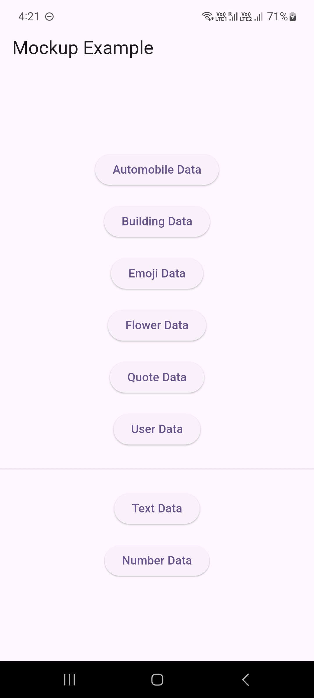
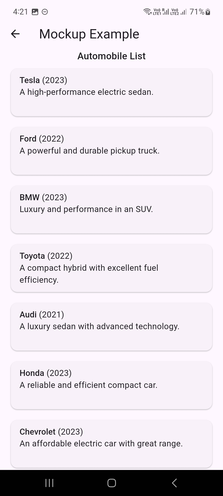
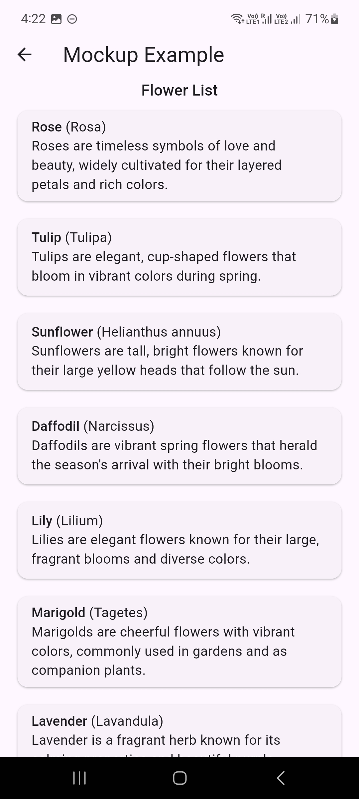
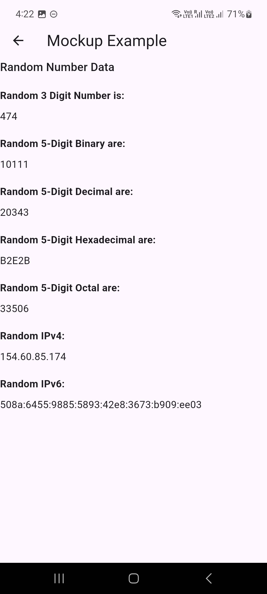
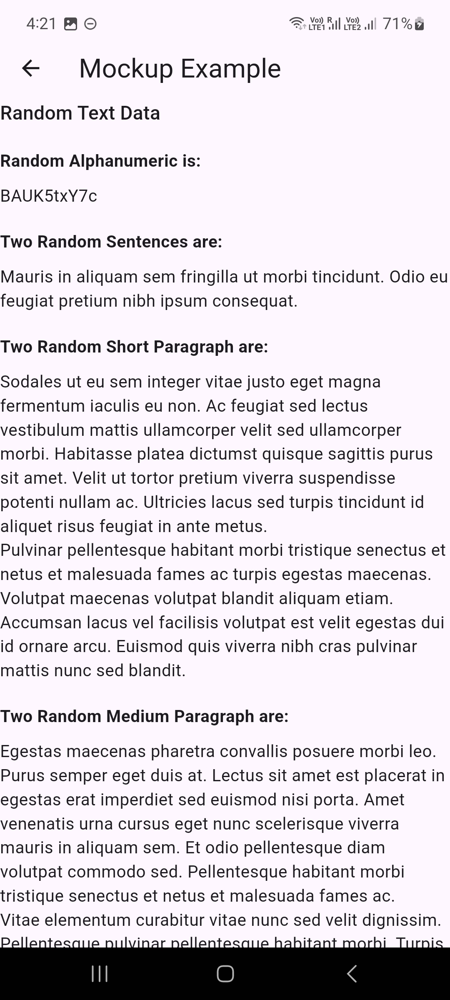

# 📦 Mockup
**Mockup** is a Flutter package that generates ready-to-use dummy data—perfect for building UI screens, testing components, demo apps, and prototyping without API dependencies.

---

## ✨ Features
- 🚀 **Instant mock data** for common categories (users, quotes, automobiles, buildings, emojis, flowers & more)
- 🧪 **Ideal for UI testing**, demo screens & component previews
- 📄 **Text generator** for sentences & paragraphs
- 🔢 **Number utilities** including random numbers & formatted system values (hex/binary/octal/IP)
- 🔗 **No backend required** — works completely offline

---

## 🎯 Perfect For
- UI/UX prototyping without waiting for backend
- Placeholder screen designs / Figma-to-Flutter conversions
- Automated widget & integration tests
- Mock JSON data for demos
- Classroom & training projects

---
## 🚀 Installation

Add `mockup` to your `pubspec.yaml`:

```yaml
dependencies:
  mockup: ^1.0.2
```

Or use the command line for quick setup:

```bash
flutter pub add mockup
```

## Usage

The `mockup` package provides an easy way to fetch predefined data for multiple categories such as automobiles, buildings, emojis, flowers, quotes, and users.

### 🔧 Example

```dart
import 'package:mockup/mockup.dart';

void main() {
  // Get 5 mock user records
  final users = Mockup.user.getItems(5);

  // Get a random quote
  final quote = Mockup.quote.getRandomItem();

  // Generate random text
  final paragraph = Mockup.text.generateShortParagraph(1);

  print(users);
  print(quote.text);
  print(paragraph);
}
```

### 📦 Available Data Categories

| Category   | Methods                                                                                    |
| ---------- | ------------------------------------------------------------------------------------------ |
| Automobile | `getAll()`, `getItems()`, `getRandomItem()`, `getShuffledList()`, `getItemAt()`, `rawJson` |
| Building   | Same methods                                                                               |
| Emoji      | Same methods                                                                               |
| Flower     | Same methods                                                                               |
| Quote      | Same methods                                                                               |
| User       | Same methods                                                                               |

### Example Usage (More Detailed)

```dart
final cars = Mockup.automobile.getAll();

final randomCar = Mockup.automobile.getRandomItem();

final buildings = Mockup.building.getItems(10);

final buildingAtIndex = Mockup.building.getItemAt(2);

final emojis = Mockup.emoji.getShuffledList();

final randomEmoji = Mockup.emoji.getRandomItem();

final quoteOfTheDay = Mockup.quote.getRandomItem();
```
---

### ✍️ Text Generation

```dart
final randomString = Mockup.text.randomAlphanumeric;
final sentences = Mockup.text.generateSentences(numberOfSentence: 2);
final paragraph = Mockup.text.generateMediumParagraph(1);
```

---

### 🔢 Number Utilities
```dart
final random3Digit = Mockup.number.randomDigit(100, 999);
final bin = Mockup.number.randomBinaryString(5);
final hex = Mockup.number.randomHexString(5);
final ipv4 = Mockup.number.randomIPv4();
```

--- 

## 📸 Gallery

|  Main          |  Automobile |  Flower |
|----------------------------------------------------------------------------------------------------------|-------------------------------------------------------------------------------------------------------------|-----------------------------------------------------------------------------------------------------|
|  Number Data |  Text Data        |                                                                                                     |

--- 

## 💡Contributing
Pull requests are welcome. For major changes, please open an issue first to discuss what you would like to change.

---

## 📄 License
[MIT](https://choosealicense.com/licenses/mit/)

---

## ⭐ Support

- If you like the project, please star on GitHub & like on pub.dev 🙌
- It helps support development and future updates.