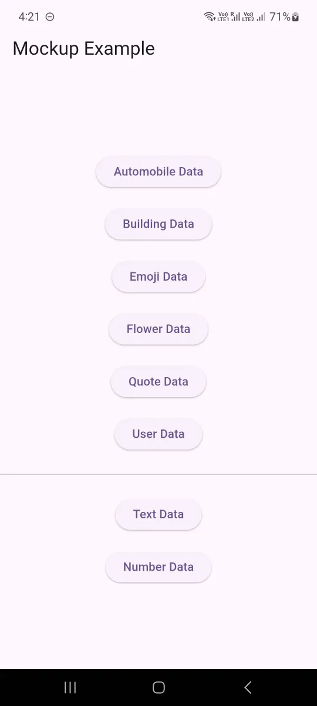
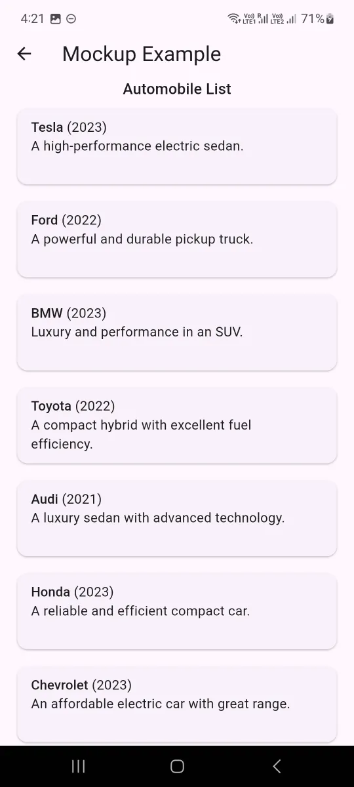
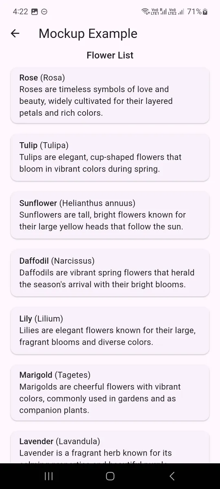
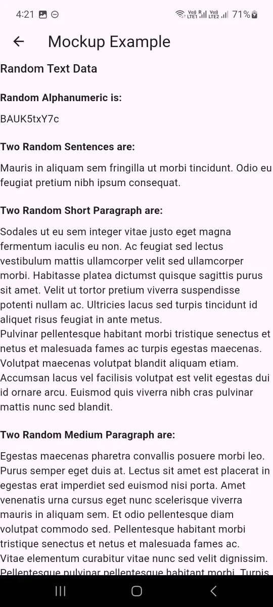

[](https://pub.dev/packages/mockup)
[](https://pub.dev/packages/mockup/score)
[](https://github.com/rohitsinghorg/mockup/actions/workflows/ci.yml)
[](https://pub.dev/packages/mockup)

[](LICENSE)

# 📦 Mockup

**Realistic, typed mock data for Flutter, plus a fake backend to go with it.**

Build and test screens before your API exists. Mockup gives you ready-made
records (users, quotes, cars, buildings, flowers, emoji), value generators
(text, numbers, dates, emails, UUIDs…) and a simulated API with latency,
pagination and errors. It all works offline, and every value is reproducible
in tests.

```dart
final users = Mockup.user.getItems(20);                         // List<UserModel>
final page  = await Mockup.quote.fetchPage(1, pageSize: 10);    // simulated API call
final title = Mockup.text.title();                              // "Sapien Libero Quis"
```

<p>
  
  
  
  
</p>

## Contents

- [Why Mockup?](#why-mockup)
- [Installation](#installation)
- [Quick start](#quick-start)
- [Data categories](#data-categories)
- [Simulating an API](#simulating-an-api)
- [Testing with seeds](#testing-with-seeds)
- [Working with models](#working-with-models)
- [Value generators](#value-generators)
- [Recipes](#recipes)
- [FAQ](#faq)
- [Migrating from 1.x](#migrating-from-1x)

---

## Why Mockup?

Value generators such as [`faker`](https://pub.dev/packages/faker) produce
individual fake values: a name, a sentence, an address. Mockup works one level
up, at the screen level:

| You need… | Mockup gives you |
| --- | --- |
| A list screen full of believable content | Typed, internally consistent records: `Mockup.user.getItems(20)` |
| Loading spinners, pagination and error states | `fetchPage`, `fetchItems`… with latency and random failures |
| JSON to stub an HTTP client or API mock | `rawJson` on every category |
| Stable golden and widget tests | `Mockup.seed(42)` makes every value reproducible |
| One-off values for forms and fields | Text, number, date and internet generators |

Use whichever fits; they also work well together.

---

## Installation

```bash
flutter pub add mockup
```

or add it to `pubspec.yaml` yourself:

```yaml
dependencies:
  mockup: ^2.0.0
```

Many projects only use mock data in tests. In that case, add it under
`dev_dependencies` instead (`flutter pub add dev:mockup`).

---

## Quick start

```dart
import 'package:flutter/material.dart';
import 'package:mockup/mockup.dart';

class UserList extends StatelessWidget {
  const UserList({super.key});

  @override
  Widget build(BuildContext context) {
    final users = Mockup.user.getItems(30);
    return ListView.builder(
      itemCount: users.length,
      itemBuilder: (context, i) => ListTile(
        title: Text('${users[i].firstName} ${users[i].lastName}'),
        subtitle: Text(users[i].occupation ?? ''),
      ),
    );
  }
}
```

---

## Data categories

| Category | Model | Records | Example |
| --- | --- | ---: | --- |
| `Mockup.user` | `UserModel` (+ `Address`) | 15 | Ava Thompson, Data Analyst, Chicago |
| `Mockup.quote` | `QuoteModel` | 43 | "Life is like riding a bicycle…" (Albert Einstein) |
| `Mockup.automobile` | `AutomobileModel` | 20 | Tesla Model S, 2023, Electric |
| `Mockup.building` | `BuildingModel` | 19 | Empire State Building, New York, 1931 |
| `Mockup.flower` | `FlowerModel` | 15 | Rose (*Rosa*), Perennial |
| `Mockup.emoji` | `EmojiModel` | 4,032 | 😂 face with tears of joy, `:joy:` |

Every category shares the same API:

| Method | Returns |
| --- | --- |
| `getAll()` | Every item (read-only list) |
| `getItems(count)` | Exactly `count` items, cycling when `count` exceeds the data |
| `getItemAt(index)` | The item at `index` (wraps around) |
| `getRandomItem()` | A random item |
| `getShuffledList()` | All items in random order (modifiable copy) |
| `getPage(page, pageSize:, totalItems:)` | One [`MockPage`](#simulating-an-api) of results |
| `fetchAll()`, `fetchItems()`, `fetchRandomItem()`, `fetchPage()` | Async versions with simulated latency and failures |
| `rawJson` | The raw JSON maps, for mocking API responses |

```dart
final cars = Mockup.automobile.getAll();
final buildings = Mockup.building.getItems(10);
final third = Mockup.building.getItemAt(2);
final emojis = Mockup.emoji.getShuffledList();
final quoteOfTheDay = Mockup.quote.getRandomItem();
```

### Field reference

All fields are nullable and `final`. Every field is filled in the bundled
data except `EmojiModel.order`, which is only present for about 30% of emoji.

<details>
<summary><b>UserModel</b> and <b>Address</b></summary>

| Field | Type | JSON key | Description |
| --- | --- | --- | --- |
| `prefix` | `String` | `prefix` | Title or prefix for the user's name: "Mr.", "Ms.", "Mrs." or "Dr." |
| `firstName` | `String` | `first_name` | User's first name |
| `lastName` | `String` | `last_name` | User's last name |
| `nickName` | `String` | `nick_name` | User's nickname or preferred name |
| `gender` | `String` | `gender` | Gender of the user ("Male" or "Female") |
| `image` | `String` | `image` | URL of the user's profile photo |
| `email` | `String` | `email` | Email address of the user |
| `age` | `int` | `age` | Age of the user |
| `mobile` | `String` | `mobile` | Mobile phone number of the user |
| `address` | `Address` | `address` | Address details of the user |
| `occupation` | `String` | `occupation` | Occupation or job title of the user |
| `maritalStatus` | `String` | `marital_status` | Marital status of the user: "Single", "Married", "Divorced" or "Widowed" |
| `education` | `String` | `education` | Education level or degree of the user |

**Address**

| Field | Type | JSON key | Description |
| --- | --- | --- | --- |
| `addressLine1` | `String` | `address_line1` | First line of the street address |
| `addressLine2` | `String` | `address_line2` | Second line of the street address (e.g., apartment or suite number) |
| `city` | `String` | `city` | City of residence |
| `locality` | `String` | `locality` | Locality or neighborhood name |
| `state` | `String` | `state` | State or province |
| `country` | `String` | `country` | Country name |
| `zipCode` | `String` | `zip_code` | ZIP or postal code |
| `latitude` | `double` | `latitude` | Latitude coordinate of the location |
| `longitude` | `double` | `longitude` | Longitude coordinate of the location |

</details>

<details>
<summary><b>QuoteModel</b></summary>

| Field | Type | JSON key | Description |
| --- | --- | --- | --- |
| `id` | `String` | `id` | Unique identifier for the quote |
| `author` | `String` | `author` | Name of the person who said or wrote the quote |
| `quote` | `String` | `quote` | The text of the quote itself |
| `themes` | `List<String>` | `themes` | List of lowercase themes associated with the quote (e.g., "life", "perseverance") |
| `quoteType` | `String` | `quote_type` | The type of quote: "Motivational", "Inspirational" or "Philosophical" |

</details>

<details>
<summary><b>AutomobileModel</b></summary>

| Field | Type | JSON key | Description |
| --- | --- | --- | --- |
| `id` | `String` | `id` | Unique identifier for the automobile |
| `make` | `String` | `make` | Manufacturer of the automobile |
| `model` | `String` | `model` | Model name of the automobile |
| `year` | `int` | `year` | Manufacturing year of the automobile |
| `fuelType` | `String` | `fuel_type` | Type of fuel used by the automobile: "Electric", "Gasoline", "Diesel" or "Hybrid" |
| `isEcoFriendly` | `bool` | `is_eco_friendly` | Indicates whether the automobile is environmentally friendly |
| `horsepower` | `int` | `horsepower` | Engine power measured in horsepower |
| `mileage` | `double` | `mileage` | Fuel efficiency in miles per gallon (MPG); for electric cars, the range in miles |
| `rating` | `double` | `rating` | User or expert rating of the automobile on a 0–5 scale |
| `shortDescription` | `String` | `short_description` | Brief description of the automobile |
| `description` | `String` | `description` | Detailed description of the automobile |
| `features` | `List<String>` | `features` | List of notable features and specifications of the automobile |

</details>

<details>
<summary><b>BuildingModel</b></summary>

| Field | Type | JSON key | Description |
| --- | --- | --- | --- |
| `id` | `String` | `id` | Unique identifier for the building |
| `name` | `String` | `name` | Name of the building |
| `location` | `String` | `location` | Geographical location of the building |
| `yearBuilt` | `int` | `year_built` | Year when the building was constructed |
| `floors` | `int` | `floors` | Number of floors in the building |
| `areaSqm` | `double` | `area_sqm` | Total area of the building in square meters |
| `buildingType` | `String` | `building_type` | Category of the building (e.g., "Commercial", "Museum", "Monument") |
| `hasParking` | `bool` | `has_parking` | Indicates whether the building has parking facilities |
| `architect` | `String` | `architect` | Name of the architect or firm that designed the building |
| `elevation` | `double` | `elevation` | Height of the building in meters |
| `description` | `String` | `description` | Detailed description of the building |
| `facilities` | `List<String>` | `facilities` | List of amenities and facilities available in the building |

</details>

<details>
<summary><b>FlowerModel</b></summary>

| Field | Type | JSON key | Description |
| --- | --- | --- | --- |
| `id` | `String` | `id` | Unique identifier for the flower |
| `commonName` | `String` | `common_name` | Widely recognized name of the flower |
| `scientificName` | `String` | `scientific_name` | Taxonomic name of the flower |
| `colors` | `List<String>` | `colors` | Available color variations of the flower |
| `bloomingSeason` | `String` | `blooming_season` | Period when the flower normally blooms |
| `symbolism` | `List<String>` | `symbolism` | Cultural meanings associated with the flower |
| `nativeRegion` | `String` | `native_region` | Geographical areas where the flower naturally occurs |
| `fragrance` | `bool` | `fragrance` | Whether the flower has a scent |
| `sunRequirements` | `String` | `sun_requirements` | Amount of sunlight needed for optimal growth |
| `waterRequirements` | `String` | `water_requirements` | Water needs for proper cultivation |
| `plantType` | `String` | `plant_type` | Classification of the plant: "Perennial", "Annual" or "Deciduous Shrub" |
| `price` | `double` | `price` | Approximate cost per plant (no currency is specified) |
| `shortDescription` | `String` | `short_description` | Brief overview of the flower |
| `description` | `String` | `description` | Detailed information about the flower |

</details>

<details>
<summary><b>EmojiModel</b></summary>

| Field | Type | JSON key | Description |
| --- | --- | --- | --- |
| `emoji` | `String` | `emoji` | The emoji character itself |
| `name` | `String` | `name` | Full descriptive name of the emoji |
| `shortname` | `String` | `shortname` | Shortcode format used in some applications (e.g., :smile:) |
| `unicode` | `String` | `unicode` | Space-separated Unicode code points of the emoji (e.g., "1f602") |
| `html` | `String` | `html` | HTML entity representation of the emoji |
| `category` | `String` | `category` | The category and subcategory the emoji belongs to (e.g., "Smileys & Emotion (face-smiling)") |
| `order` | `int` | `order` | Sort order of the emoji within the Unicode emoji list |

</details>

---

## Simulating an API

Every category can behave like a slow, unreliable backend, so you can build
loading, pagination and error states before the real API exists.

```dart
// Completes after Mockup.defaultDelay (500 ms by default)
final users = await Mockup.user.fetchItems(20);

// Custom latency, failing 20% of the time with a MockupException
try {
  final quotes = await Mockup.quote.fetchAll(
    delay: const Duration(seconds: 2),
    failureRate: 0.2,
  );
} on MockupException catch (e) {
  print(e.message); // Simulated network error
}
```

### Pagination

```dart
// Pages of 20 out of a simulated collection of 200 users
final page = await Mockup.user.fetchPage(1, pageSize: 20, totalItems: 200);

page.items;       // List<UserModel>, 20 items
page.totalPages;  // 10
page.hasNextPage; // true
page.nextPage;    // 2 (null on the last page)
print(page);      // MockPage(page: 1/10, items: 20, totalItems: 200)
```

* Pages are **1-based**; a page past the end is empty.
* `totalItems` can exceed the bundled data; items cycle just like `getItems`.
* `getPage` is the synchronous version.

The example app's
[API Simulation screen](https://github.com/rohitsinghorg/mockup/blob/master/example/lib/screen/api_simulation_screen.dart)
puts this together: infinite scroll, a loading footer, random failures and a
Retry button.

---

## Testing with seeds

Seed the generator so "random" data is identical on every run. This keeps
goldens and assertions stable:

```dart
setUp(() {
  Mockup.seed(42);                     // reproducible output
  Mockup.defaultDelay = Duration.zero; // fetch* calls complete immediately
});

tearDown(() => Mockup.seed());         // back to truly random
```

With the same seed, the same sequence of calls always returns the same values.
Results may differ between Dart versions and between the VM and the web, so
generate goldens on the platform that runs them.

> In `testWidgets`, simulated delays run on the fake clock: advance it with
> `await tester.pump(const Duration(milliseconds: 500))`, or set
> `Mockup.defaultDelay = Duration.zero`.

---

## Working with models

Models are immutable and support value equality, a readable `toString`,
`copyWith` and JSON conversion:

```dart
final user = Mockup.user.getItemAt(0);
print(user);
// UserModel(prefix: Ms., firstName: Ava, lastName: Thompson, nickName: Avie, ...)

final renamed = user.copyWith(firstName: 'Jane');
print(user == Mockup.user.getItemAt(0)); // true
print(user == renamed);                  // false

final json = user.toJson();              // snake_case keys, e.g. "first_name"
final copy = UserModel.fromJson(json);   // == user
```

---

## Value generators

Example outputs below are real values from the generators.

### Text

```dart
Mockup.text.words(3);              // "sollicitudin ultricies habitasse"
Mockup.text.title();               // "Egestas Tincidunt A"
Mockup.text.slug();                // "sodales-aliquam-turpis"
Mockup.text.alphanumeric(16);      // "EvPXZbR21lbJI4fW"
Mockup.text.generateSentences(numberOfSentence: 2);
// "Lorem ipsum dolor sit amet consectetur adipiscing. Enim blandit volutpat ..."
Mockup.text.generateShortParagraph();   // 3–5 sentences
Mockup.text.generateMediumParagraph(2); // two paragraphs of 5–8 sentences
Mockup.text.generateLongParagraph();    // 8–15 sentences
```

### Numbers

```dart
Mockup.number.randomDigit(100, 999);   // 966 (inclusive range)
Mockup.number.randomDouble(0, 5);      // 3.548596531926452
Mockup.number.randomBool(0.8);         // true 80% of the time
Mockup.number.randomPrice(max: 500);   // 57.5 (2 decimals max)
Mockup.number.randomHexString(5);      // "6426F"
Mockup.number.randomBinaryString(8);   // "10110010"
Mockup.number.randomIPv4();            // "174.90.134.248"
Mockup.number.randomIPv6();            // "c25a:ca67:137b:e275:6a25:813b:9740:4acf"
Mockup.number.randomPhoneNumber();     // "+1-396-555-0111"
Mockup.number.randomHexColor();        // "#464D55"
Color(Mockup.number.randomColor());    // opaque ARGB int, e.g. 0xFF811499
```

Phone numbers use the 555-0100 to 555-0199 range, which is reserved for fiction.

### Dates

```dart
Mockup.date.between(DateTime(2020), DateTime(2021)); // 2020-08-31 15:42:19.548
Mockup.date.past(within: const Duration(days: 30));  // within the last 30 days
Mockup.date.future();                                // within the next year
Mockup.date.birthday(minAge: 18, maxAge: 65);        // 2008-02-19 (no time part)
```

`past`, `future` and `birthday` accept `from:` instead of "now", so they can
be fully reproducible in tests.

### Internet

```dart
Mockup.internet.uuid();      // "fde33dcb-9cf7-49e1-b32b-8b100d98d0e7" (v4)
Mockup.internet.username();  // "ava_garcia97"
Mockup.internet.email();     // "satoshi.mthembu54@example.org"
Mockup.internet.url();       // "https://www.example.com/ac-ante-ac"
```

Emails and URLs only use the reserved `example.com`, `example.org` and
`example.net` domains, so they can never reach a real person.

---

## Recipes

### A fake repository behind your real interface

Code against an interface and swap in Mockup until the backend is ready:

```dart
abstract interface class UserRepository {
  Future<MockPage<UserModel>> users(int page);
}

class FakeUserRepository implements UserRepository {
  @override
  Future<MockPage<UserModel>> users(int page) =>
      Mockup.user.fetchPage(page, pageSize: 20, totalItems: 100, failureRate: 0.1);
}
```

### Stubbing an HTTP client

`rawJson` returns API-shaped JSON. For example, with `MockClient` from
[`package:http`](https://pub.dev/packages/http):

```dart
import 'dart:convert';
import 'package:http/http.dart' as http;
import 'package:http/testing.dart';

final client = MockClient((request) async => http.Response(
      jsonEncode(Mockup.quote.rawJson),
      200,
      headers: {'content-type': 'application/json'},
    ));
```

### A FutureBuilder with loading and error states

Create the future once (in a `State` field), not inside `build`, or every
rebuild starts a new request:

```dart
// In your State class
late final _quotes = Mockup.quote.fetchItems(10, failureRate: 0.3);

// In build()
FutureBuilder<List<QuoteModel>>(
  future: _quotes,
  builder: (context, snapshot) {
    if (snapshot.hasError) return const Text('Something went wrong');
    if (!snapshot.hasData) return const CircularProgressIndicator();
    return Column(
      children: [for (final q in snapshot.data!) Text(q.quote ?? '')],
    );
  },
)
```

### Generic widgets for any category

`JsonDataProvider<T>` is the common type of every category:

```dart
List<T> preview<T>(JsonDataProvider<T> source) => source.getItems(3);

preview(Mockup.user);   // List<UserModel>
preview(Mockup.flower); // List<FlowerModel>
```

---

## FAQ

**Does it need an internet connection?**
No. All data is bundled with the package. The only exception is
`UserModel.image`: those profile photos are hosted on
[randomuser.me](https://randomuser.me), so showing them needs a network
connection.

**Does the emoji data make my app bigger?**
Only if you use it. Release builds drop code you don't reference: an app that
uses `Mockup.user` but not `Mockup.emoji` doesn't include the emoji data, which
is about 1 MB of compiled size. Each category's data is also parsed lazily, the
first time you use it.

**Why does `getAll().add(...)` throw?**
`getAll()` returns the shared, read-only data. Use `getShuffledList()` or
`getAll().toList()` for a copy you can modify.

**Is the data realistic enough for production demos?**
Records are curated and internally consistent (for example, each user's
email matches their name), but the datasets are small. Use `getItems(n)` or
`totalItems` to fill longer lists; items repeat once the data runs out.

**Can I make the simulated API faster in tests?**
Yes: set `Mockup.defaultDelay = Duration.zero`, or pass `delay:` per call.

---

## Migrating from 1.x

- **Model fields are `final`.** Replace assignments such as
  `user.firstName = 'x'` with `user.copyWith(firstName: 'x')`.
- **User JSON keys are now snake_case** (`first_name`, `last_name`,
  `nick_name`, `marital_status`, `address_line1`, `address_line2`,
  `zip_code`), matching the other categories. This affects
  `Mockup.user.rawJson`, `UserModel.toJson()` and `UserModel.fromJson()`.
  Dart property names are unchanged.
- `getAll()` returns a read-only list (since 1.1.0).

See the [changelog](CHANGELOG.md) for everything new in 2.0.0.

---

## Contributing

Issues and pull requests are welcome! See [CONTRIBUTING.md](CONTRIBUTING.md)
for setup, tests and how to add a new data category.

## License

[MIT](LICENSE)

## Support

If Mockup saves you time, please ⭐ the repo on
[GitHub](https://github.com/rohitsinghorg/mockup) and 👍 like it on
[pub.dev](https://pub.dev/packages/mockup). It really helps!
